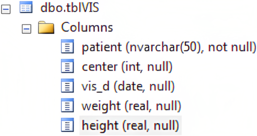

# Data competency assessment <!-- omit in toc -->

- [Dependencies](#dependencies)
- [Instructions](#instructions)
- [Submission](#submission)
- [Overview](#overview)
- [Assessment (Section A: Theory) \[20 marks\]](#assessment-section-a-theory-20-marks)
- [Assessment (Section B: Practical) \[45 marks\]](#assessment-section-b-practical-45-marks)
  - [**Question 1: Data Imports \[30 marks, approx. 70 minutes\]**](#question-1-data-imports-30-marks-approx-70-minutes)
  - [**Question 2: Data Transformation \[15 marks, approx. 40 minutes\]**](#question-2-data-transformation-15-marks-approx-40-minutes)
    - [Dataset columns](#dataset-columns)

## Dependencies

You should have received the following notes by email prior to the assessment:

1. You will need approximately 2 hours free to complete this assessment.
2. You will need an a GitHub account with multi-factor authentication enabled.
3. You will need your reviewers GitHub username or email address.
4. You will need `git` installed on your machine. If you are a Windows user, you can download it from [here](https://git-scm.com/downloads).
5. We suggest using Visual Studio Code to complete the assessment. You can download it from [here](https://code.visualstudio.com/download). If you have a preferred text editor or IDE, you are welcome to use that instead, but VS Code has excellent support for markdown editing (See [Markdown preview](https://code.visualstudio.com/docs/languages/markdown#_markdown-preview)).
6. You can assume that your reviewer has SQL Server Management Studio 2017, `python 3` and `pip3` installed on their machine. If you wish to use a different language, please provide a comprehensive environment setup guide. The reviewer will make a best-effort attempt at following your instructions, but you will be penalised if your instructions have missing steps or are unclear. For your decision making, at least one portion of the assessment will require the writing of unit tests. 
7. It is advantageous to use `python` and `MSSQL` as these are the languages used by the team, but this will only differentiate well-matched candidates.
7. If you are using a relational database language (e.g., `MSSQL`, `MySQL`, `SQLite`, `Postgres` etc.), you should have a blank database with full administrative rights to create objects and generate scripts. 
8. If you do not have access to a machine to complete this assessment, please contact us to arrange an in-person assessment.
9. `git` is a standard and is essential for anyone writing code in an organisation committed to sustainable practices. If you are unfamiliar with `git` and unable to familiarise yourself with it prior to the assessment, please do inform us, and you could send your scripts to us in an alternative manner. Note, that submissions in `git` are *strongly* preferred and only candidates with stand-out skills in other areas will be considered without a `git` submission. 
10. If you have repositories of your work that you can share with us please do so.

> **Note**: If you were not previously instructed on the above, please let your reviewer know immediately and you may have an additional **45 minutes** to complete the assessment.

## Instructions 

This competency assessment consists of a theory section and a practical component.

1. Answers should be committed in this `README.md` underneath the relevant sections.
2. Please fork this repository to your own GitHub account and do your work on the `main` branch.
2. When adding any files for submission, prepend to the file name the section and question number you're responding to in the following format: `sec_b_ques_1_1_2_yourname`. Please add:
   - output data to the `data` folder as a **tab delimited text file**.
   - tests to the `tests` folder.
   - scripts to the `code` folder.
   - images to the `assets` folder.
3. You must provide instructions for running your code, ideally copy-pastable commands. The instructions should work on Windows unless you do not have a Windows machine, in which case please state this at submission. If your code requires any dependencies or installations, please list them in the instructions. 
4. You can find the data files (`lab_data.txt` and `medicine_data.csv`) for the practical section in the `data` folder. 
6. Your answers to `Section A: Theory` should be one commit, and your answers to each question in `Section B: Practical` should each be a separate commit. Please give your commits appropriate messages.
7. Where necessary, please use code fencing to denote code blocks in markdown. See: [Markdown: Fenced Code Blocks](https://www.markdownguide.org/extended-syntax/#fenced-code-blocks), with correct highlighting, if applicable.
9. You may use the internet to assist you with your answers.
10. There is a bonus question at the end of the assessment. Please do not rush to get to it as it will not affect the assessment and does not count. It is merely a showcase.

## Submission

> **Note**: Once you have completed the assessment, please email a link to your forked repository to your reviewer within 3 hours of starting the assessment. 
   
You will need to give your reviewer access to your forked repository. You can do this by going to `Settings > Manage Access` and adding your reviewer as a collaborator.
## Overview

- The theory section should take approximately 30 minutes to complete. 
- The practical section should take approximately 90 minutes to complete, however you have extra time. 

## Assessment (Section A: Theory) [20 marks]

1. The Provincial Health Data Centre contains data from multiple different sources and acquires data in different formats. List at least 3 factors that would be crucial for harmonising data into a consolidated environment.  

**[3 marks]**

---
**Answer A.1**  
Please answer here.

---
 
2. You have written a query for a complex dataset with multiple calculations that returns millions of records. The query is performing poorly, provide at least 3 points describing how you would optimise the query. 

**[2 marks]**

---
**Answer A.2**  
Please answer here.

---

3. An ETL pipeline has been developed that fetches data from source, imports it into a staging area where transformations are completed and then loads the data into a standardised repository, from which report queries are run. A user has identified that there is an error in a report. Give at least 5 points describing how you would go about debugging the code and mitigating such errors in future. 

**[2 marks]**

---
**Answer A.3**  
Please answer here.

---

4. The PHDC houses extremely sensitive health data. Legislations have come into effect both internationally and locally (e.g. POPIA, the protection of personal information act) to protect sensitive data. Give at least 3 points briefly describing what you would implement on an environment you manage to be able to report on who accessed sensitive data and when.

**[2 marks]**

---
**Answer A.4**  
Please answer here.

---

5.  You are asked to onboard a new dataset from a database maintained by cardiologists for patients with congenital heart defects. Take us through your approach to this. 

**[1 mark]**

---
**Answer A.5**  
Please answer here.

---

6. There is a table called `dbo.tblART` in the SQL database, which contains antiretroviral therapy (ART) drug data. The codes for the ART drugs have changed and an update needs to be applied to the table. ART table columns are as follows:

<p align="center">
  
</p>

The coding for the `art_id` column has been given as follows:

<div align="center">

| old_code | new_code | art_drug_description |
| :-: | :-: | :-: |
| J05AG-ETV | J05AG04 | Etravirine (TMC 125) |
| J05AE-TPR | J05AE09 | Tipranavir (Aptivus) |
</div>

Please write an example of a SQL statement that will enable you to update the information to reflect the new coding for the two drugs. If you do not know any SQL language you may code the update in the coding language of your choice.

**[2 marks]**

---
**Answer A.6**  
Please answer here (use code fencing with the appropriate language to denote code block).


---

7. There has also been an error picked up in the height variable of the dbo.tblVIS table for one of the Centers, called KESS with Center number 3. All measurements for height should be recorded in centimetres, however there are some recorded in metres. The VIS table columns are as follows:

<p align="center">
  
</p>

Small sample of the data set:

<div align="center">

| patient | center | vis_d | weight | height |
| :-: | :-: | :-: | :-: | :-: |
| 1 | 1 | 2020-01-01 | 70.5 | 145 |
| 2 | 3 | 2020-05-01 | 65 | 1.25 |
| 3 | 2 | 2020-05-04 | 28 | 89 |
| 4 | 3 | 2020-08-01 | 35 | 0.78 |
| 5 | 1 | 2020-04-01 | 68 | 160 |
| 6 | 3 | 2020-05-01 | 88 | 175 |
</div>

Please write an SQL statement to correct this error to standardise the measurement to centimetres. If you do not know any SQL language you may code the update in the coding language of your choice.

**[3 marks]**

---
**Answer A.7**  
Please answer here (use code fencing with the appropriate language to denote code block).

---

8. The Levenshtein distance algorithm (see [here](http://www.kodyaz.com/articles/fuzzy-string-matching-using-levenshtein-distance-sql-server.aspx)) is often used to perform imprecise matching between records, with a lower distance signalling a closer match (with zero being an exact match). For example the computed Levenshtein distance for the two strings _medical_ and _radical_ is two, meaning that two edits are needed to change one string into the other. A known MS SQL implementation of the Levenchtein distance algorithm is shown in the code block below. Please modify the function to include a parameter which if set to 1 returns the distance as a percentage of the length of the longer of the two strings, and if set to 0 (default) returns the edit distance as in the original version. Place the modified function script in the `code` folder.

```sql
CREATE FUNCTION edit_distance(@s1 nvarchar(3999), @s2 nvarchar(3999))
RETURNS int
AS
BEGIN
 DECLARE @s1_len int, @s2_len int
 DECLARE @i int, @j int, @s1_char nchar, @c int, @c_temp int
 DECLARE @cv0 varbinary(8000), @cv1 varbinary(8000)

 SELECT
  @s1_len = LEN(@s1),
  @s2_len = LEN(@s2),
  @cv1 = 0x0000,
  @j = 1, @i = 1, @c = 0

 WHILE @j <= @s2_len
  SELECT @cv1 = @cv1 + CAST(@j AS binary(2)), @j = @j + 1

 WHILE @i <= @s1_len
 BEGIN
  SELECT
   @s1_char = SUBSTRING(@s1, @i, 1),
   @c = @i,
   @cv0 = CAST(@i AS binary(2)),
   @j = 1

  WHILE @j <= @s2_len
  BEGIN
   SET @c = @c + 1
   SET @c_temp = CAST(SUBSTRING(@cv1, @j+@j-1, 2) AS int) +
    CASE WHEN @s1_char = SUBSTRING(@s2, @j, 1) THEN 0 ELSE 1 END
   IF @c > @c_temp SET @c = @c_temp
   SET @c_temp = CAST(SUBSTRING(@cv1, @j+@j+1, 2) AS int)+1
   IF @c > @c_temp SET @c = @c_temp
   SELECT @cv0 = @cv0 + CAST(@c AS binary(2)), @j = @j + 1
 END

 SELECT @cv1 = @cv0, @i = @i + 1
 END

 RETURN @c
END
```
**[5 marks]**

---
**Answer A.8**  
Please add any notes, instructions or other information here.

---

## Assessment (Section B: Practical) [45 marks]

For this practical assessment you have been given the following two files in the `data` folder:

- **laboratory_data.txt**: This contains HbA1c test results for diabetic patients including: patient 
ID, sex, date of birth, lab test type, lab test date, and lab test result.
- **medicine_data.csv**: This contains medicine dispensing data for diabetic patients including: 
patient ID, sex, date of birth, medicine name, and dispensing date.

> **Note**: Please note that the patient ID is a unique identifier for the patient; i.e., each unique person has one "patient ID" that can be used to identify them.

### **Question 1: Data Imports [30 marks, approx. 70 minutes]**

1. Using a language of your choice, write a script to import the data and add that script to the `code` folder. Review the data you have imported and complete the answer block in the answers section under B.1.1.

**[7 marks]**

2. Add a unit test to the repository (`tests` folder), with instructions for use, and test the data import script (the test must call the script to acquire the data it asserts over), asserting:
   - The number of columns in each file.
   - The number of rows in each file.
   - The number of unique patient IDs in each file.

**[18 marks]**

3. Add a GitHub Action to the repository that runs the unit tests on each commit to the `main` branch. 

> **Note**: It may be best to prototype on another branch or repo unless you have a clear understanding of how to rewrite your `git`` history.

References: 

   - [Build and test example for python](https://docs.github.com/en/actions/automating-builds-and-tests/building-and-testing-python)
   - [Workflow syntax](https://docs.github.com/en/actions/using-workflows/workflow-syntax-for-github-actions)
   - [Understanding github actions](https://docs.github.com/en/actions/learn-github-actions/understanding-github-actions)


**[5 marks]**

---
**Answer B.1.2 and B.1.3**  

Please add any notes, instructions or other information here.

**Answer B.1.1** 

<div align="left">

| | laboratory_data.txt | medicine_data.csv | 
| :- | :-: | :-: | 
| What is the column delimiter in the file? |  |  |
| How many columns are in the file? |  |  |
| How many lines are in the file (excluding the header)? |  |  |
| How many unique patients are in the file? |  |  |
</div>

---

### **Question 2: Data Transformation [15 marks, approx. 40 minutes]**

In this question you will be required to construct a wide dataset that could be used to track each individual patient's health. Your dataset should contain one line per patient and should contain the columns listed below.  

Write a script to transform the data into a wide format and output it to a file in the data folder (in the format described in the instructions). Add your script to the `code` folder. 

Your dataset must have the following columns:

#### Dataset columns

1. **Patient ID**
2. **Sex** -- Standardised as either "M" or "F"
3. **Age category** -- Calculate the age in years as of today's date and categorise into the following age brackets: 
   - `<30`
   - `30-39`
   - `40-49`
   - `50-59`
   - `>=60`
4. **Medicine category** -- Categorise the medications the patient is taking into the following drug categories:
   - Insulin only
   - Metformin only
   - Insulin AND metformin
   - No drugs dispensed
5. **Last medicine dispensing date** -- i.e. the date corresponding with the most recent dispensing 
of medicines
6. **Number of times medicines were dispensed** -- i.e. count of times medicines have been dispensed
7. **HbA1c test date**
8. **HbA1c test result**
9. **Diabetic treatment follow up flag** -- This should be a binary field (1/0), where a value of 1 indicates that the patient has a uncontrolled HbA1c (HbA1c >=8) OR they are not taking medication.

---
**Answer B.2**  
Please add any notes, instructions or other information here.

---
## **[Bonus]: Data Visualisation** <!-- omit in toc -->

> **Note**: This question is not compulsory and will have no penalties on the review of this assessment. You may choose to do this question if you have extra time.

1. Create a visualisation of the data imported. Your visualisation should include at least the following indicators (you may include other indicators too):
   - Medicine dispensing categories stratified by age group
   - Diabetic treatment follow up flag stratified by age group and medicine category
2. Please state the software you used and include a screenshot of the visualisation in the `assets` folder.
---
**Answer Bonus.1**  
Please add any notes here.

---


