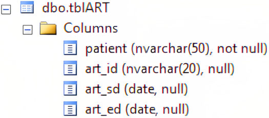

# Data competency assessment <!-- omit in toc -->

- [Dependencies](#dependencies)
- [Instructions](#instructions)
- [Submission](#submission)
- [Overview](#overview)
- [Assessment (Section A: Theory)](#assessment-section-a-theory)
- [Assessment (Section B: Practical)](#assessment-section-b-practical)
  - [**Question 1: Data Imports \[30 marks, approx. 70 minutes\]**](#question-1-data-imports-30-marks-approx-70-minutes)
  - [**Question 2: Data Transformation \[15 marks, approx. 40 minutes\]**](#question-2-data-transformation-15-marks-approx-40-minutes)
    - [Dataset columns](#dataset-columns)

## Dependencies

You should have received the following notes by email prior to the assessment:

1. You will need approximately 2 hours free to complete this assessment.
2. You will need an a GitHub account with multi-factor authentication enabled.
3. You will need your reviewers GitHub username or email address.
4. You will need git installed on your machine. If you are a Windows user, you can download it from [here](https://git-scm.com/downloads).
5. We suggest using Visual Studio Code to complete the assessment. You can download it from [here](https://code.visualstudio.com/download). If you have a preferred text editor or IDE, you are welcome to use that instead, but VS Code has excellent support for markdown editing (See [Markdown preview](https://code.visualstudio.com/docs/languages/markdown#_markdown-preview)).
6. You can assume that your reviewer has `python 3` and `pip3` installed on their machine. If you wish to use a different language, please provide a comprehensive environment setup guide. The reviewer will make a best-effort attempt at following your instructions, but you will be penalised if your instructions have missing steps or are unclear. For your decision making, at least one portion of the assessment will require the writing of unit tests. It is advantageous to use Python and/or MSSQL. 
7. If you are using a relational database language to complete the test (e.g. MS SQL, MySQL, SQLite, Postgres etc.) you should have a blank database set up where you have full administrative rights to create objects and generate scripts that would create the database and all objects. If you are using a relational database language please also script a database backup that we could restore. 
8. If you do not have access to a machine of your own on which to complete this assessment, please contact us to arrange an in-person assessment.
9. Git is a widely used standard that is essential to the toolkit of anyone writing code in an organisation committed to sustainable practices. If you are unfamiliar with git and unable to familiarise yourself with it prior to the assessment, please do inform us, and you could send your scripts to us in an alternative manner. However it would be highly advantageous that you utilise git and candidates who do not may be at a relative disadvantage.

> **Note**: If you were not previously instructed on the above, please let your reviewer know immediately and you may have an additional **45 minutes** to complete the assessment.

## Instructions 

This competency assessment consists of a theory section and a practical component.

1. Answers should be committed in this `README.md` underneath the relevant sections.
2. Do your work on the `main` branch.
3. You must provide instructions for running your code, ideally copy-pastable commands. The instructions should work on Windows unless you do not have a Windows machine, in which case please state this at submission. If your code requires any dependencies or installations, please list them in the instructions. You can assume `python 3` and `pip3` is installed on the reviewers machine.
4. You can find the data files (`lab_data.txt` and `medicine_data.csv`) for the practical section in the `data` folder.
5. Please place scripts in the `code` folder and unit tests in the `tests` folder.
6. Should you need to add any images or screenshots, please place them in the assets folder and embed them in the markdown document (See: [Markdown: Basic Syntax](https://www.markdownguide.org/basic-syntax/#images-1)).
7. Your answers to `Section A: Theory` should be one commit, and your answers to `Section B: Practical` should each be a separate commit. Please give your commits appropriate messages.
8. Where necessary, please use code fencing to denote code blocks in markdown. See: [Markdown: Fenced Code Blocks](https://www.markdownguide.org/extended-syntax/#fenced-code-blocks), with correct highlighting, if applicable.
9. You may use the internet to assist you with your answers.
10. There is a bonus question at the end of the assessment. Please do not rush to get to it as it will not affect the assessment and does not count. It is merely a showcase.

> **Note**: Once you have completed the assessment, please email a link to your forked repository to your reviewer within 3 hours of starting the assessment. 

## Submission
   
Please fork this repository to your own GitHub account. You will need to give your reviewer access to your forked repository. You can do this by going to `Settings > Manage Access` and adding your reviewer as a collaborator.
## Overview

- The theory section should take approximately 30 minutes to complete. 
- The practical section should take approximately 90 minutes to complete, however you have 
extra time. 

## Assessment (Section A: Theory)

1. The Provincial Health Data Centre contains data from multiple different sources and acquires data in different formats. List at least 3 factors that would be crucial for harmonising data into a consolidated environment.  

**[3 marks]**

---
**Answer A.1**  
Please answer here.

---
 
2. At the Provincial Health Data Centre we often receive requests for data for analysis purposes, whereby it is unnecessary for the analyst to know the identity of the patient. As part of your work you may have to release a fully de-identified dataset (i.e., a dataset from which you could not re-identify the patients included). List at least two points describing how you could obfuscate the data so that it could not be re-identified.  

**[2 marks]**

---
**Answer A.2**  
Please answer here.

---

3. An HbA1c level of 6.5% or more is considered high enough to diagnose diabetes, while values lower than 6.5% indicate healthy patients. A programmer incorrectly wrote the code to identify diabetics as: HbA1c > 6.5% and as such 300 patients with HbA1c = 6.5% were classified as healthy patients. In statistical terms, what could those 300 patients could be classified as? 

**[2 marks]**

---
**Answer A.3**  
Please answer here.

- [ ] False positives
- [ ] False negatives
- [ ] Type 1 error

---

4. Knowing the medication a patient is taking often can indicate what health condition they have. For example if a patient is regularly prescribed insulin it is likely that they have chronic diabetes. However, in some cases patients that do not have chronic diabetes may be given insulin for short periods in hospital. Suppose there was a register of all patients who have been diagnosed with chronic diabetes by a doctor. You have been tasked with trying to reproduce this register based on insulin dispensing data alone. What statistical term would best describe the percentage of patients with chronic diabetes who were correctly identified as having the condition?

**[2 marks]**

---
**Answer A.4**  
Please answer here.

- [ ] Specificity
- [ ] Sensitivity
- [ ] True negative rate

---

5. There are two laboratory tests that can be used to monitor HIV over time, viral load and CD4 count. An HIV+ patient on treatment will typically have one viral load and CD4 count test per year. When preparing data for an analyst they might request the dataset in "long" or "wide" format. 
Which of the following dataset descriptions best describes a "wide" dataset?

**[1 mark]**

---
**Answer A.5**  
Please answer here.

- [ ] Each line in the dataset contains one test result, with only a few columns
- [ ] Each line in the dataset contains one patient, with multiple columns

---

6. There is a table called `dbo.tblART` in the SQL database, which contains antiretroviral therapy (ART) drug data. The codes for the ART drugs have changed and an update needs to be applied to the table. ART table columns are as follows:

  

The coding for the `art_id` column has been given as follows:

| old_code | new_code | art_drug_description |
| :-: | :-: | :-: |
| J05AG-ETV | J05AG04 | Etravirine (TMC 125) |
| J05AE-TPR | J05AE09 | Tipranavir (Aptivus) |

Please write an example of a SQL statement that will enable you to update the information to reflect the new coding for the two drugs. If you do not know any SQL language you may code the update in the coding language of your choice.

**[2 marks]**

---
**Answer A.6**  
Please answer here (use code fencing with the appropriate language to denote code block).

---

7. There has also been an error picked up in the height variable of the dbo.tblVIS table for one of the Centers, called KESS with Center number 3. All measurements for height should be recorded in centimetres, however there are some recorded in metres. The VIS table columns are as follows:

  

Small sample of the data set:

| patient | center | vis_d | weight | height |
| :-: | :-: | :-: | :-: | :-: |
| 1 | 1 | 2020-01-01 | 70.5 | 145 |
| 2 | 3 | 2020-05-01 | 65 | 1.25 |
| 3 | 2 | 2020-05-04 | 28 | 89 |
| 4 | 3 | 2020-08-01 | 35 | 0.78 |
| 5 | 1 | 2020-04-01 | 68 | 160 |
| 6 | 3 | 2020-05-01 | 88 | 175 |

Please write an SQL statement to correct this error to standardise the measurement to centimetres. If you do not know any SQL language you may code the update in the coding language of your choice.

**[3 marks]**

---
**Answer A.7**  
Please answer here (use code fencing with the appropriate language to denote code block).

---

## Assessment (Section B: Practical)

For this practical assessment you have been given the following two files in the `data` folder:

- **laboratory_data.txt**: This contains HbA1c test results for diabetic patients including: patient 
ID, sex, date of birth, lab test type, lab test date, and lab test result.
- **medicine_data.csv**: This contains medicine dispensing data for diabetic patients including: 
patient ID, sex, date of birth, medicine name, and dispensing date.

> **Note:** Please note that the patient ID is a unique identifier for the patient; i.e., each unique person has one "patient ID" that can be used to identify them.

### **Question 1: Data Imports [30 marks, approx. 70 minutes]**

1. Using a language of your choice, write a script to import the data and add it to the `code` folder. Review the data you have imported by completing the table in the answer block below.

**[5 marks]**

---
**Answer B.1.1**

| | laboratory_data.txt | medicine_data.csv | 
| :- | :-: | :-: | 
| What is the column delimiter in the file? |  |  |
| How many columns are in the file? |  |  |
| How many lines are in the file (excluding the header)? |  |  |
| How many unique patients are in the file? |  |  |

---

2. Add unit tests to the repository (`tests` folder), with instructions for use, and test the data import script, asserting:
   - The number of columns in each file.
   - The number of rows in each file.
   - The number of unique patient IDs in each file.

**[15 marks]**

3. Add a GitHub Action to the repository that runs the unit tests on each commit to the `main` branch. 

**[10 marks]**

---
**Answer B.1.2 and B.1.3**  

Please add any notes, instructions or other information here.

---

### **Question 2: Data Transformation [15 marks, approx. 40 minutes]**

In this question you will be required to construct a wide dataset that could be used to track each individual patient’s health. Your dataset should contain one line per patient and should contain the columns listed below.  

Write a script to transform the data into a wide format, output it to a file and add it to the `code` folder. 

Your dataset must have the following columns:

#### Dataset columns

1. **Patient ID**
2. **Sex** -- Standardised as either "M" or "F"
3. **Age category** -- Calculate the age in years as of today’s date and categorise into the following age brackets: 
   - `<30`
   - `30-39`
   - `40-49`
   - `50-59`
   - `>=60`
4. **Medicine category** -- Categorise the medications the patient is taking into the following drug categories:
   - Insulin only
   - Metformin only
   - Insulin AND metformin
   - No drugs dispensed
5. **Last medicine dispensing date** -- i.e. the date corresponding with the most recent dispensing 
of medicines
6. **Number of times medicines were dispensed** -- i.e. count of times medicines have been dispensed
7. **HbA1c test date**
8. **HbA1c test result**
9. **Diabetic treatment follow up flag** -- This should be a binary field (1/0), where a value of 1 indicates that the patient has a uncontrolled HbA1c (HbA1c >=8) OR they are not taking medication.

---
**Answer B.2**  
Please add any notes, instructions or other information here.

---
### **[Bonus] Question 3: Data Visualisation** <!-- omit in toc -->
> **Note:** This question is not compulsory and will have no penalties on the review of this assessment. You may choose to do this question if you have extra time.
1. Create a visualisation of the data imported. Your visualisation should include at least the following indicators (you may include other indicators too). Please state the software you used and include a screenshot of the visualisation in the `assets` folder.
- Medicine dispensing categories stratified by age group
- Diabetic treatment follow up flag stratified by age group and medicine category
---
**Answer Bonus.1**  
Please add any notes here.

---
